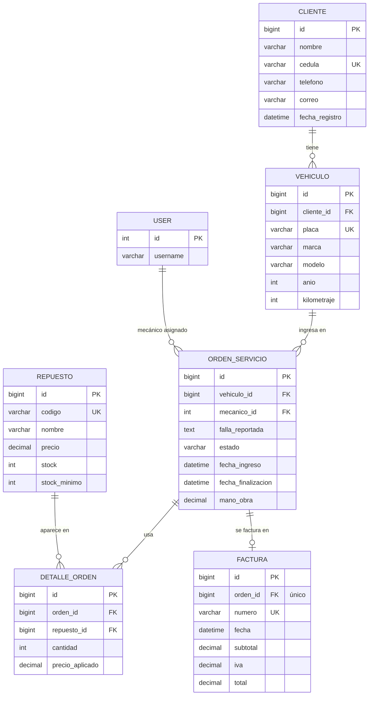

# Documentación técnica: Taller Mecánico API

Proyecto Programado #1, Desarrollo de Software IV, UCR Sede del Pacífico.

## 1. Problema y solución

Los talleres pequeños suelen llevar su control en cuadernos o por mensajes: no saben qué repuestos les quedan, pierden el historial de cada vehículo y cobran mal los repuestos usados.

La API controla el ciclo completo de un vehículo en el taller:

```
Cliente → Vehículo → Orden de servicio → Repuestos usados → Finalización → Factura
```

**Decisiones que automatiza el sistema:**
- Descuenta el inventario cuando se usa un repuesto y lo devuelve si se corrige o se quita.
- Rechaza usar más repuestos de los disponibles.
- Controla que los estados de la orden avancen en orden.
- Calcula subtotal, IVA y total de la factura.
- Bloquea cualquier cambio a una orden ya facturada.

---

## 2. Módulos (RF-01)

| App | Modelo(s) | Entradas | Salidas | Se relaciona con |
|---|---|---|---|---|
| `clientes` | Cliente | nombre, cédula, teléfono, correo | datos del cliente | vehiculos (1:N) |
| `vehiculos` | Vehiculo | cliente, placa, marca, modelo, año, kilometraje | vehículo con nombre del cliente; historial de órdenes | clientes, ordenes |
| `repuestos` | Repuesto | código, nombre, precio, stock, stock mínimo | datos del repuesto y su stock | ordenes (N:M) |
| `ordenes` | OrdenServicio, DetalleOrden | vehículo, mecánico, falla, mano de obra; repuesto y cantidad | orden con sus repuestos usados | vehiculos, repuestos, usuarios, facturacion |
| `facturacion` | Factura | orden finalizada | factura con número, subtotal, IVA y total; reportes | ordenes (1:1) |

**CRUD (RF-02):** CRUD completo en clientes, vehículos, repuestos y órdenes (incluidos los detalles de la orden).
Facturación solo permite **crear y consultar**. Justificación: una factura emitida es un documento contable, así que no se modifica ni se elimina para conservar el historial. Si se intenta, la API responde 405.

---

## 3. Modelo relacional (RF-03)



GitHub muestra este diagrama como imagen. En otros editores se puede ver pegándolo en https://mermaid.live.

### Relaciones y políticas de borrado

| Relación | Tipo | `on_delete` | Justificación |
|---|---|---|---|
| Cliente → Vehiculo | 1:N | `PROTECT` | No se borra un cliente con vehículos; se perdería el historial. Responde 409. |
| Vehiculo → OrdenServicio | 1:N | `PROTECT` | Un vehículo con órdenes conserva su historial. Responde 409. |
| User (mecánico) → OrdenServicio | 1:N | `PROTECT` | No se borra un mecánico con órdenes asignadas. |
| OrdenServicio ↔ Repuesto | N:M mediante `DetalleOrden` | — | La tabla intermedia guarda la cantidad y el **precio aplicado**. |
| OrdenServicio → DetalleOrden | 1:N | `CASCADE` | Los detalles pertenecen a la orden. Solo se pueden borrar órdenes en estado Recibida, que todavía no tienen repuestos. |
| Repuesto → DetalleOrden | 1:N | `PROTECT` | Un repuesto ya usado en órdenes no se borra. Responde 409. |
| OrdenServicio → Factura | 1:1 (`OneToOneField`) | `PROTECT` | Cada orden tiene como máximo una factura, y una orden facturada no se borra. |

**Restricciones únicas:** `Cliente.cedula`, `Vehiculo.placa`, `Repuesto.codigo`, `Factura.numero`, `Factura.orden` y la pareja `(orden, repuesto)` en `DetalleOrden`.

---

## 4. Reglas de negocio (RF-06)

| # | Regla | Dónde se valida | Respuesta | Prueba automatizada |
|---|---|---|---|---|
| 1 | La cédula del cliente es única y tiene al menos 9 dígitos | `ClienteSerializer` | 400 | `test_cedula_duplicada_devuelve_400` |
| 2 | La placa es única | `unique=True` en el modelo | 400 | `test_placa_duplicada_devuelve_400` |
| 3 | El código de repuesto es único | `unique=True` en el modelo | 400 | — (misma lógica que la regla 2) |
| 4 | Precio, stock y mano de obra no pueden ser negativos, también en PATCH | Validadores del modelo y serializadores | 400 | `test_precio_negativo_y_stock_negativo_por_patch` |
| 5 | La cantidad usada debe ser mayor que cero | `DetalleOrdenSerializer.validate_cantidad` | 400 | `test_cantidad_cero_devuelve_400` |
| 6 | No se puede usar más cantidad que el stock disponible | `ordenes/views.py` | 400 | `test_stock_insuficiente_devuelve_400` |
| 7 | El inventario se mantiene coherente al usar, modificar o quitar repuestos | `ordenes/views.py` | — | `test_agregar_repuesto_descuenta_stock_y_guarda_precio`, `test_modificar_y_eliminar_detalle_mantiene_stock_coherente` |
| 8 | Se guarda el precio aplicado aunque después cambie el precio del repuesto | `DetalleOrden.precio_aplicado` | — | `test_agregar_repuesto_descuenta_stock_y_guarda_precio` |
| 9 | Los estados solo avanzan: Recibida → En reparación → Finalizada → Facturada | `cambiar_estado_api` | 400 | `test_no_se_puede_saltar_estados` |
| 10 | El estado no se cambia con PUT/PATCH, solo con `cambiar-estado` o al facturar | `orden_detalle_api` | 400 | `test_patch_no_permite_cambiar_estado_directamente` |
| 11 | Solo se agregan, cambian o quitan repuestos con la orden En reparación | `detalles_orden_api` y `detalle_api` | 400 | `test_no_se_agregan_repuestos_si_no_esta_en_reparacion` |
| 12 | Un vehículo no puede tener dos órdenes abiertas (abierta = no facturada) | `OrdenServicioSerializer.validate` | 400 | `test_no_permite_dos_ordenes_abiertas_para_el_mismo_vehiculo` |
| 13 | El mecánico asignado debe tener el rol Mecánico | `OrdenServicioSerializer.validate_mecanico` | 400 | `test_mecanico_asignado_debe_tener_rol_mecanico` |
| 14 | Solo se facturan órdenes finalizadas | `FacturaSerializer.validate_orden` | 400 | `test_no_se_factura_orden_no_finalizada` |
| 15 | Cada orden se factura una sola vez | `facturas_api` | 409 | `test_no_se_factura_dos_veces` |
| 16 | Subtotal, IVA y total los calcula el servidor; lo que envíe el cliente se ignora | `facturas_api` | — | `test_factura_calcula_totales_y_cierra_la_orden` |
| 17 | Una orden facturada y sus repuestos no se modifican, tampoco con PATCH | `orden_detalle_api`, `detalles_orden_api` | 409 | `test_orden_facturada_no_se_modifica` |
| 18 | No se eliminan registros con historial (cliente con vehículos, repuesto usado, orden con avance) | `PROTECT` y vistas | 409 | `test_eliminar_cliente_con_vehiculos_devuelve_409` |
| 19 | El año del vehículo debe estar entre 1950 y 2027 | `VehiculoSerializer.validate_anio` | 400 | — |

### Cálculo de la factura

```
subtotal = suma(cantidad × precio_aplicado de cada repuesto) + mano_obra
iva      = subtotal × 13 %      (redondeado a 2 decimales)
total    = subtotal + iva
```

La tasa usada es el **13 %**, la tarifa general del IVA en Costa Rica. Está definida como `TASA_IVA` en `facturacion/views.py`.
El número de factura es consecutivo: `FAC-1`, `FAC-2`, etc.

---

## 5. Seguridad y matriz de permisos (RF-07)

- **Autenticación:** token de Django REST Framework (`POST /api/token/`). Se envía como `Authorization: Token <clave>`.
- **Roles:** grupos de Django `Administrador`, `Recepcionista` y `Mecanico`. El superusuario cuenta como administrador.
- **Control por operación:** cada vista revisa dos cosas al inicio:
  - Si el usuario no inició sesión (sin token o token inválido) → **401**.
  - Si su rol no está permitido, usando `tiene_rol(usuario, roles)` de `taller_backend/utilidades.py` → **403**.

| Recurso / acción | Administrador | Recepcionista | Mecánico |
|---|---|---|---|
| Clientes: consultar | ✅ | ✅ | ✅ |
| Clientes: crear, modificar, eliminar | ✅ | ✅ | ❌ |
| Vehículos: consultar e historial | ✅ | ✅ | ✅ |
| Vehículos: crear, modificar, eliminar | ✅ | ✅ | ❌ |
| Repuestos: consultar | ✅ | ✅ | ✅ |
| Repuestos: crear, modificar, eliminar | ✅ | ❌ | ❌ |
| Órdenes: consultar | ✅ todas | ✅ todas | ✅ solo las suyas |
| Órdenes: abrir y modificar datos | ✅ | ✅ | ❌ |
| Órdenes: eliminar (solo en estado Recibida) | ✅ | ❌ | ❌ |
| Órdenes: cambiar estado | ✅ | ❌ | ✅ solo las suyas |
| Repuestos de la orden: agregar, modificar, quitar | ✅ | ❌ | ✅ solo las suyas |
| Facturas: crear y consultar | ✅ | ✅ | ❌ |
| Reportes | ✅ | ❌ | ❌ |

Pruebas de permisos: `test_sin_token_devuelve_401`, `test_mecanico_no_puede_crear_cliente`, `test_admin_crea_y_recepcionista_no`, `test_mecanico_no_asignado_recibe_403`, `test_mecanico_no_puede_facturar` y `test_reportes_solo_para_administrador`.

---

## 6. Catálogo de endpoints

Base: `http://127.0.0.1:8000`. Todos, excepto `/api/token/`, requieren token.

### Autenticación
| Método | Ruta | Descripción |
|---|---|---|
| POST | `/api/token/` | Obtener token (`username`, `password`) |
| GET | `/api/perfil/` | Usuario autenticado y su rol |

### Clientes
| Método | Ruta | Descripción |
|---|---|---|
| GET | `/api/clientes/` | Listar. Parámetros: `buscar` (por nombre), `page` |
| POST | `/api/clientes/` | Crear |
| GET | `/api/clientes/{id}/` | Consultar |
| PUT / PATCH | `/api/clientes/{id}/` | Modificar total o parcialmente |
| DELETE | `/api/clientes/{id}/` | Eliminar (409 si tiene vehículos) |

### Vehículos
| Método | Ruta | Descripción |
|---|---|---|
| GET | `/api/vehiculos/` | Listar. Filtros combinables: `cliente`, `marca`, `anio`; búsqueda `buscar` (por placa); `page` |
| POST | `/api/vehiculos/` | Crear |
| GET | `/api/vehiculos/{id}/` | Consultar |
| PUT / PATCH | `/api/vehiculos/{id}/` | Modificar |
| DELETE | `/api/vehiculos/{id}/` | Eliminar (409 si tiene órdenes) |
| GET | `/api/vehiculos/{id}/historial/` | Órdenes del vehículo con mecánico y repuestos |

### Repuestos
| Método | Ruta | Descripción |
|---|---|---|
| GET | `/api/repuestos/` | Listar. `buscar` (por nombre), `ordenar` (`nombre`, `precio`, `-precio`, `stock`, `-stock`), `page` |
| POST | `/api/repuestos/` | Crear |
| GET | `/api/repuestos/{id}/` | Consultar |
| PUT / PATCH | `/api/repuestos/{id}/` | Modificar |
| DELETE | `/api/repuestos/{id}/` | Eliminar (409 si ya se usó en órdenes) |

### Órdenes de servicio
| Método | Ruta | Descripción |
|---|---|---|
| GET | `/api/ordenes/` | Listar. Filtros combinables: `estado`, `mecanico`, `vehiculo`; `page` |
| POST | `/api/ordenes/` | Abrir orden (`vehiculo`, `mecanico`, `falla_reportada`, `mano_obra` opcional) |
| GET | `/api/ordenes/{id}/` | Consultar con sus repuestos |
| PUT / PATCH | `/api/ordenes/{id}/` | Modificar datos (no el estado) |
| DELETE | `/api/ordenes/{id}/` | Eliminar (solo en estado Recibida) |
| POST | `/api/ordenes/{id}/cambiar-estado/` | Avanzar estado: `{"estado": "EN_REPARACION"}` o `{"estado": "FINALIZADA", "mano_obra": "18000"}` |
| GET | `/api/ordenes/{id}/detalles/` | Repuestos usados en la orden |
| POST | `/api/ordenes/{id}/detalles/` | Agregar repuesto: `{"repuesto": 1, "cantidad": 2}` |
| GET | `/api/ordenes/detalles/{id}/` | Consultar un detalle |
| PATCH | `/api/ordenes/detalles/{id}/` | Cambiar la cantidad: `{"cantidad": 2}` (ajusta el stock) |
| DELETE | `/api/ordenes/detalles/{id}/` | Quitar el repuesto (devuelve el stock) |

### Facturación y reportes
| Método | Ruta | Descripción |
|---|---|---|
| GET | `/api/facturas/` | Listar. Filtro `cliente`; `page` |
| POST | `/api/facturas/` | Facturar una orden finalizada: `{"orden": 5}` |
| GET | `/api/facturas/{id}/` | Consultar una factura |
| GET | `/api/reportes/` | Reportes del administrador |

### Formato de los listados paginados

```json
{
  "pagina_actual": 1,
  "total_paginas": 2,
  "total_registros": 7,
  "resultados": [ ... ]
}
```

Se muestran 5 registros por página.

---

## 7. Consultas ORM (RF-04)

| # | Consulta | Dónde | Técnica |
|---|---|---|---|
| 1 | Historial del vehículo con mecánico y repuestos | `vehiculos/views.py` → `historial_vehiculo_api` | `select_related('mecanico')` + `prefetch_related('detalles')` |
| 2 | Repuestos con stock bajo el mínimo | `reportes_api` | `F('stock_minimo')`, que compara dos campos del mismo repuesto |
| 3 | Repuestos más usados | `reportes_api` | `annotate(Sum('detalles_orden__cantidad'))`, filtro por relación inversa |
| 4 | Órdenes por mecánico | `reportes_api` | `annotate(Count('ordenes_asignadas'))` |
| 5 | Órdenes por estado | `reportes_api` | `values('estado').annotate(Count('id'))` |
| 6 | Total facturado | `reportes_api` | `aggregate(Count, Sum)` |
| 7 | Facturas por cliente | `facturas_api` | Filtro a través de relaciones: `orden__vehiculo__cliente_id` |

## 8. Consultas REST (RF-05)

| Requisito | Implementación |
|---|---|
| Filtros combinables en dos recursos | Vehículos (`cliente` + `marca` + `anio`) y órdenes (`estado` + `mecanico` + `vehiculo`) |
| Búsqueda | Clientes (por nombre), vehículos (por placa) y repuestos (por nombre) |
| Ordenamiento | Repuestos: `ordenar=precio`, `-precio`, `stock`, `-stock` o `nombre` |
| Paginación | Clientes, vehículos, repuestos, órdenes y facturas |

## 9. Códigos HTTP (RF-08)

| Código | Cuándo |
|---|---|
| 200 | Consulta o modificación correcta |
| 201 | Registro creado |
| 204 | Registro eliminado |
| 400 | Datos inválidos o regla de negocio incumplida |
| 401 | Sin token o token inválido |
| 403 | El rol no tiene permiso, o la orden pertenece a otro mecánico |
| 404 | El registro no existe |
| 405 | Método no permitido (por ejemplo, DELETE de una factura) |
| 409 | Conflicto con el estado actual: orden ya facturada, factura duplicada o registro protegido |

Los errores se devuelven en JSON con mensajes en español (`{"error": "..."}`, `{"detail": "..."}` o el campo con el problema), sin trazas internas.

---

## 10. Decisiones técnicas

Estas son algunas decisiones del diseño y por qué hacen falta:

- **`taller_backend/utilidades.py`:** tiene dos funciones pequeñas, `tiene_rol` y `es_mecanico`, para revisar el rol del usuario sin repetir la misma consulta en todas las vistas.
- **Grupos de Django para los roles:** es la forma más sencilla de Django para tener perfiles sin crear modelos nuevos. Se administran desde `/admin/`.
- **Comando `cargar_datos`:** carga roles, usuarios y datos ficticios con un solo comando.
- **`taller_backend/pruebas_base.py`:** prepara usuarios, tokens y datos para todas las pruebas, para no repetirlo en cada archivo.
